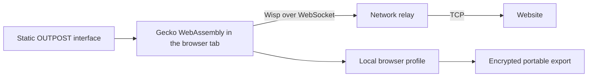

<div align="center">

# ▦ OUTPOST

**Take your browser session with you.**

A browser that runs inside your browser, with encrypted profiles you can export, clear, and reopen on another device.

[**Open the live demo**](https://aagneyvk.github.io/outpost/) · [Run locally](#run-locally) · [Architecture](#architecture) · [MIT License](LICENSE)

</div>

## What OUTPOST does

OUTPOST runs a WebAssembly build of Gecko in a browser tab. You can browse in a separate profile, export your open tabs and website sessions with a passphrase, clear the local Gecko profile, and import the archive in a fresh browser. The demo requires no OUTPOST account or installation.

| Feature | GitHub Pages | Local checkout |
| --- | --- | --- |
| Gecko browsing with tabs, history, and zoom | Yes | Yes |
| Encrypted browser profile export, import, and cleanup | Yes | Yes |
| Browser Files for local uploads and downloads | Yes | Yes |
| Linux terminal and guest filesystem | Requires a local guest build | Yes, after building the optional runtime |
| Bundled Node network relay | Static hosting uses a separate Wisp endpoint | Yes |

## Try the portable browser workflow

1. Open [OUTPOST](https://aagneyvk.github.io/outpost/) in desktop Chrome. On the first visit, a service worker sets the isolation headers Gecko needs and may reload the page once.
2. Click **Start browser**, then enter a website address. OUTPOST uses the Wisp endpoint selected under **Network settings**.
3. Click **Exit & export** when you’re done. Enter a passphrase and download the encrypted `.outpost` profile. Choose **Export and clear browser profiles** if you also want to remove the Gecko profiles from this browser on the current address. Confirm after checking the download.
4. On the second device, open OUTPOST, expand **Encrypted browser profile**, and import the file with its original passphrase. Start the browser to reopen the saved tabs.

Website sessions can expire or require another sign-in. The verified restore test uses a synthetic site with a persistent HttpOnly cookie. Browser Files and Linux workspace data have separate storage and export paths.

## Run locally

Install Node.js 24 or newer, then run:

```sh
git clone https://github.com/AagneyVk/outpost.git
cd outpost
npm ci
npm start
```

Open [http://127.0.0.1:3001/](http://127.0.0.1:3001/). The bundled Gecko release is included. MercuryWorkshop’s public demo relay is selected by default. Clear the custom endpoint to use the local Node relay, or enter another authorized `wss://` endpoint.

### Optional Linux workspace

On the Windows build machine, start Docker Desktop and run:

```sh
npm run build:runtime
npm start
```

The runtime build downloads and generates guest assets. After it completes, **Terminal** appears in the toolbar. The guest boots on demand inside the visitor’s browser and connects its shell directly to a browser terminal. The Linux Files panel shows the guest filesystem. The main Files page uses browser storage and opens without Linux.

The generated Linux filesystem exceeds GitHub Pages’ site size limit. See [hosting instructions](HOSTING.md) for deployment details.

## Architecture



- **Browser engine.** Gecko runs locally, renders to a canvas, and validates destination HTTPS certificates.
- **Network.** Wisp carries connections over WebSockets. The relay opens TCP connections and forwards bytes. The relay can see destination and traffic metadata, and plain HTTP traffic is visible to it.
- **Storage.** The active Gecko profile lives in browser origin storage. Exports are encrypted in the browser using AES-GCM and a key derived with PBKDF2-SHA256. The archive can contain active website sessions, so keep it private.
- **Hosting.** GitHub Pages serves the app and engine files. The default relay is a public demo endpoint operated by MercuryWorkshop. Its production availability is unverified.

## Development and verification

```sh
npm test
node tools/gecko-wasm/verify-https.mjs
node tools/gecko-wasm/verify-profile.mjs
```

Run the browser checks with the preview server running. The HTTPS check uses desktop Edge, and the profile check uses Chrome with synthetic website traffic. The profile test checks tab restoration, a signed-in page, history cleanup, and confirmed removal of the local profile.

| Path | Purpose |
| --- | --- |
| `public/gecko-lab/` | Browser UI, Files, profile management, and Gecko assets |
| `public/workstation.*` | Linux workspace UI and runtime integration |
| `server.mjs`, `relay.mjs` | Local HTTP server and Wisp-compatible relay |
| `runtime/` | Linux guest build and workspace tooling |
| `tools/gecko-wasm/` | Browser tests and native zoom source patch |
| `tools/build-pages.mjs` | Static GitHub Pages build |

## Current limits

- Tabs share one Gecko view. Switching tabs reloads the selected page. Unsaved forms and live background activity do not travel with the export.
- Native page zoom still needs a rebuilt Gecko engine. The current preview scales its canvas at zoom levels above 100%.
- Clear browser profiles removes the Gecko profile for the current OUTPOST address. Browser Files, Linux saves, and downloaded exports have separate lifecycles.
- New Gecko exports use exactly eight characters with a number and a symbol. Short passphrases are easier to guess, especially if an attacker has the archive.
- OUTPOST has no independent security audit or public uptime guarantee.

## Contributing and license

See [CONTRIBUTING.md](CONTRIBUTING.md) for contribution guidance and [SECURITY.md](SECURITY.md) for reporting vulnerabilities.

OUTPOST’s original code is available under the [MIT License](LICENSE). Bundled components retain their own licenses, including the Gecko build and pixel fonts. See [third-party notices](THIRD_PARTY.md), the [Gecko license](public/gecko-lab/engine/LICENSE), and the [font licenses](public/theme/).
